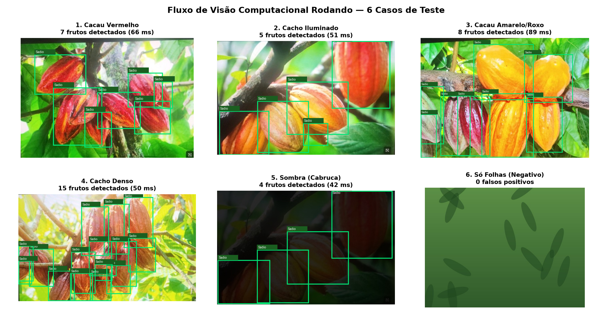
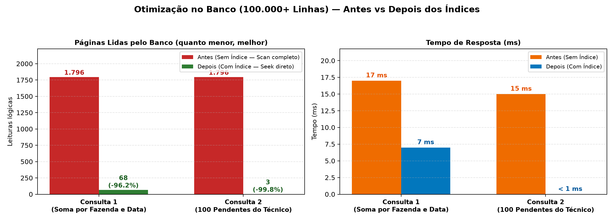
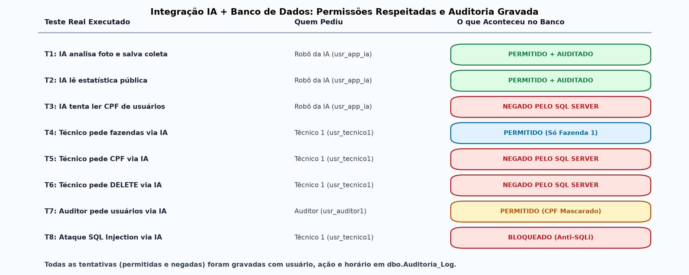

# ENTREGA DE PROJETO (17/11/2026) — IA & SEGURANÇA E OTIMIZAÇÃO DE BD
**Projeto:** CacauApp2 — Contagem e Monitoramento de Cacau Offline com Banco Seguro  
**Repositório:** https://github.com/Igor8818/cacauapp2  
**Disciplinas:** Inteligência Artificial + Segurança e Otimização de Banco de Dados  
**Regras atendidas:** Sem SaaS/site/aplicação web; dados 100% fictícios; chaves e modelos `.tflite`/`.pt` fora do Git.

---

## Integrantes do Grupo

| Nº | Nome Completo |
|---|---|
| 01 | IGOR SENA HAGGE |
| 02 | IAN SILVA BORGES |
| 03 | FERNANDO GUSTAVO |
| 04 | FELIPE SOUZA |
| 05 | VICTOR TADEU |

---

## 1. PARTE COMUM (Todos)

### 1.1 Relatório de Andamento

**O que já funciona**

- **App Android (`CacauApp2`)**: câmera ao vivo offline com modelo YOLO `.tflite`, Tela de Revisão para o técnico corrigir frutos, Modo Rota (planilha CEPLAC), exportação CSV pt-BR e testes unitários passando (`gradlew testDebugUnitTest`).
- **Banco de Dados (`CacauAppBD` no SQL Server)**: tabelas criadas e populadas com **100.003 coletas** fictícias, 4 papéis (`GRANT`/`DENY`), mascaramento de CPF/E-mail (DDM), senha com hash SHA-256, filtro por fazenda (RLS) e 2 índices que reduzem leituras em até **99,8%**.
- **IA + Integração Segura (`ia/`)**: ponte CLI (`cacau_ia_db_bridge.py`) rodando a detecção, respeitando as permissões do usuário no SQL Server e gravando cada acesso na tabela `dbo.Auditoria_Log`.

**O que falta**

- Conectar o botão de envio direto do celular ao SQL Server via rede local segura (hoje a carga passa por CSV e pela ponte CLI local).
- Coletar mais fotos rotuladas em campo de *Vassoura-de-Bruxa* e *Monilíase* na sombra densa da cabruca.
- Gravar vídeo curto demonstrativo no celular físico junto aos testes do banco.

**O que mudou na arquitetura desde 27/10/2026**

- Em **27/10**, o banco existia apenas como um rascunho de 10 linhas de SQL no PDF; agora o **SQL Server (`CacauAppBD`) está rodando de verdade** com **100.003 linhas**, papéis `GRANT`/`DENY`, proteção de dados (DDM, SHA-256 e RLS) e planos de execução medidos antes e depois dos índices.
- Foi criada a ponte local **`ia/cacau_ia_db_bridge.py`** (sem site/SaaS) para a IA consultar e inserir no banco usando o perfil do solicitante e registrando tudo em `dbo.Auditoria_Log`.
- Foram formalizados o versionamento dos parâmetros da IA (`v1` → `v2`) e os testes comparativos entre o modelo base e o modelo treinado para cacau.

**Principais Riscos**

- Sombra muito escura debaixo das árvores esconder frutos verdes pequenos (mitigado pelo Gamma LUT e pela Tela de Revisão manual).
- Tentativa de exclusão ou consulta indevida de dados pessoais (mitigado por `DENY`, RLS e DDM diretamente no SQL Server).
- Subida acidental de senhas ou modelos `.tflite`/`.pt` no Git (mitigado por `.gitignore` e `.env.example`).

### 1.2 Contribuição Individual — Igor Sena Hagge

> Desenvolvi e organizei a base do aplicativo Android `CacauApp2` (detecção TFLite com Letterbox, compensação de sombra e revisão manual), implementei todos os scripts reais de criação, volume (100.000+ linhas), segurança (`GRANT`/`DENY`, DDM, SHA-256, RLS) e otimização por índices no SQL Server (`sql/`), e construí a ponte CLI de integração IA ↔ Banco com trilha de auditoria (`ia/`).

---

## 2. PARTE DE IA (Visão Computacional — Aprovada pela Disciplina)

*(Projeto aprovado pela docente utilizando **Visão Computacional embarcada offline** como componente de IA, sem chatbot/site.)*

### 2.1 Fluxo de Ponta a Ponta em Execução

Foto do cacaueiro → Ajuste Letterbox (`640x640`) + realce de sombra (Gamma LUT) → Modelo YOLO offline (`detector.tflite` / `best-doenca.pt`) → Filtro de caixas duplicadas → Revisão do técnico → Gravação controlada no SQL Server + Auditoria.

### 2.2 Configurações Versionadas (`v1` → `v2`)

- **Versão 1.0 (`ia/configs/pipeline_v1.json`)**: esticava a imagem sem manter proporção e usava confiança mínima alta (`0.55`), perdendo frutos pequenos ou na sombra.
- **Versão 2.0 Atual (`ia/configs/pipeline_v2.json`)**: usa **Letterbox `640x640`**, reduz o limiar para **`0.25`**, aplica **Gamma LUT `0.72`** em fotos escuras e remove caixas duplicadas com **IoS (`0.65`)** (recuperando frutos extras em cachos sem gerar falsos positivos).

### 2.3 Primeiros Casos de Teste (6 Casos Reais)

| Caso | Imagem de Entrada | Resultado Esperado | Resultado Obtido | Status |
|---|---|---|---|---|
| **CT-01** | Cacau Vermelho | Detectar cacho principal (7–8 frutos) | **7** frutos `Sadio` (FT) / **8** no TFLite v2 | OK |
| **CT-02** | Cacho Iluminado | Identificar 4–5 frutos no tronco | **5** frutos `Sadio` (FT) / **4** no TFLite v2 | OK |
| **CT-03** | Cacau Amarelo/Roxo | Superar versão v1 (7) em cacho misto | v1: 7 → v2: **8** frutos (`Sadio`) | OK |
| **CT-04** | Cacho Denso | Separar vários frutos próximos (>10) | v1: 10 → v2: **12** no TFLite / **15** no FT | OK |
| **CT-05** | Sombra (Cabruca) | Ativar realce de sombra e contar frutos | Gamma LUT ativo: **4** frutos detectados | OK |
| **CT-06** | Só Folhas (Negativo) | Zero falsos positivos sem frutos | **0** frutos no TFLite v2 e **0** no FT | OK |

### 2.4 Experimento de Fine-Tuning, Custo e Latência

- **Treino vs Modelo Base**: Partindo do modelo genérico `yolo11n.pt` (COCO), foi feito fine-tuning por **339 épocas** (`best-doenca.pt`) para 4 classes (`Sadio`, `PodridaoParda`, `Moniliase`, `VassouraBruxa`), atingindo **94,2% de mAP@50** e **92,9% de precisão**.
- **Comparação direta**: Nas 5 fotos de cacau, o modelo base sem treino acertou **0 frutos de cacau** (confundiu com maçã, laranja e banana) e errou **6 vezes** na foto só com folhas (`surfboard`); o modelo treinado detectou **39 frutos corretos** e teve **0 erros** nas folhas.
- **Latência e Custo Medidos**: Média em CPU de **57,6 ms/foto** (`best-doenca.pt`) e **268,1 ms/foto** (`detector.tflite`). **Custo: R$ 0,00 por 1.000 análises** (roda 100% offline no aparelho).

---

## 3. PARTE DE SEGURANÇA E OTIMIZAÇÃO DE BD (SQL Server)

### 3.1 Papéis, `GRANT` / `DENY` e Proteção de Dados Sensíveis

- **4 papéis criados e testados (`19/19` testes aprovados)** em `sql/03_roles_grant_deny_rls.sql` e `sql/04_security_verification.sql`: `Tecnico_Campo`, `Auditor_Agronomo`, `Admin_Sistema` e `Role_App_IA`.
- **Proteção de Dados Sensíveis funcionando**:
  - **Mascaramento (DDM)** no CPF e E-mail: o Auditor vê **`111.***.***-01`**; só o Admin (`UNMASK`) vê o CPF real.
  - **Hash SHA-256** (`HASHBYTES`) na coluna `senha_hash`, que possui `DENY SELECT` para todos os perfis comuns.
  - **Row-Level Security (RLS)**: `usr_tecnico1` vê apenas os **10.000** registros da Fazenda 1 (`FAZ-01`) e `usr_tecnico2` vê apenas os **10.000** da Fazenda 2 (`FAZ-02`), enquanto o Auditor vê todas as **10 fazendas**.

### 3.2 Volume da Base e Otimização de 2 Consultas Lentas

- **Volume real confirmado no banco**: **`100.003` linhas** em `Coletas`, **`10`** em `Fazendas`, **`5`** em `Usuarios` e **`9`** registros em `Auditoria_Log`.
- **Consulta 1 (Soma de frutos por fazenda e data)**: Sem índice fazia *Clustered Index Scan* (**1.796 leituras lógicas**, `17 ms`). Com `IX_Coletas_FazendaData` passou a fazer *Index Seek* (**68 leituras**, `7 ms` — **96,2% menos páginas lidas**).
- **Consulta 2 (`TOP 100` pendentes ordenadas por data)**: Sem índice fazia *Scan + Sort* (**1.796 leituras lógicas**, `15 ms`). Com `IX_Coletas_UsuarioStatusData` (incluindo `id_fazenda` no `INCLUDE`) eliminou o `Sort` e caiu para **3 leituras lógicas** e **`< 1 ms`** (**99,8% menos páginas lidas**).

---

## 4. PARTE DE INTEGRAÇÃO (IA + Permissões + Auditoria)

- **IA respeitando permissões**: A ponte `ia/cacau_ia_db_bridge.py` roda sempre sob `EXECUTE AS USER` do perfil solicitante. Quando a IA ou um Técnico tentam ler CPFs (`dbo.Usuarios`), apagar registros (`DELETE`) ou enviar SQL Injection (`' OR 1=1; DROP TABLE...`), o acesso é **negado diretamente** e o dado nunca é exposto.
- **Auditoria registrada**: Toda ação dispara um registro automático em `dbo.Auditoria_Log` com **quem pediu, o que consultou, quando e se foi permitido ou negado**.

| ID | Data / Hora | Quem Pediu | Papel | O que Consultou / Tentou | Resultado |
|---|---|---|---|---|---|
| 9 | 2026-11-16 | `usr_tecnico1` | `Tecnico_Campo` | Prompt com SQL Injection (`OR 1=1; DROP...`) | `BLOQUEADO_SQLI` |
| 8 | 2026-11-16 | `usr_auditor1` | `Auditor_Agronomo` | Consulta `dbo.Usuarios` (CPF mascarado DDM) | `PERMITIDO` |
| 7 | 2026-11-16 | `usr_tecnico1` | `Tecnico_Campo` | Tentativa de `DELETE` em `dbo.Coletas` | `NEGADO` |
| 6 | 2026-11-16 | `usr_tecnico1` | `Tecnico_Campo` | Tentativa de ler CPF em `dbo.Usuarios` | `NEGADO` |
| 5 | 2026-11-16 | `usr_tecnico1` | `Tecnico_Campo` | Listar fazendas (RLS retorna só `FAZ-01`) | `PERMITIDO` |
| 4 | 2026-11-16 | `usr_app_ia` | `Role_App_IA` | IA tentando ler `dbo.Usuarios` | `NEGADO` |
| 3 | 2026-11-16 | `usr_app_ia` | `Role_App_IA` | IA lendo view pública sem dados pessoais | `PERMITIDO` |
| 2 | 2026-11-16 | `usr_app_ia` | `Role_App_IA` | IA salvando contagem de foto (`id_coleta=100003`) | `PERMITIDO` |
