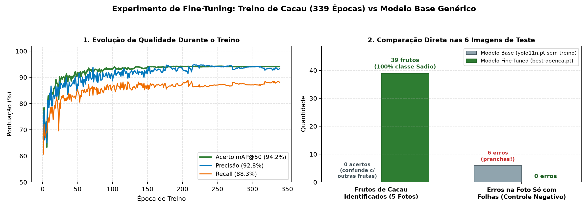
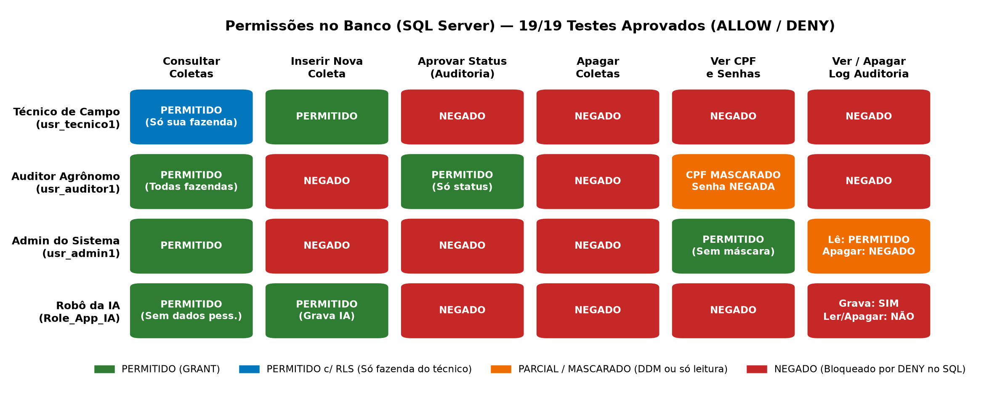
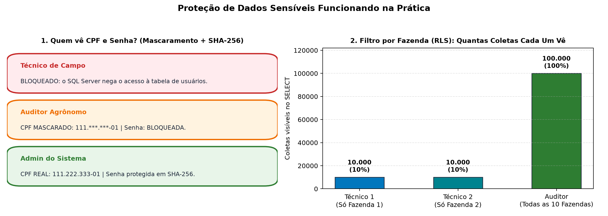
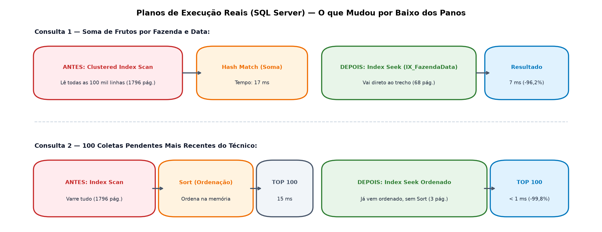

# CACAUAPP2 — RELATÓRIO RESUMIDO DE ENTREGA (17/11/2026)

**Projeto:** CacauApp2 — Contagem de Cacau Offline com Banco de Dados Seguro  
**Repositório:** https://github.com/Igor8818/cacauapp2  
**Disciplinas:** Inteligência Artificial + Segurança e Otimização de Banco de Dados  
**Diretrizes atendidas:** Funciona offline (sem site ou sistema web), dados 100% fictícios e arquivos sensíveis protegidos fora do repositório.

---

## Integrantes do Grupo

| Nº | Nome Completo |
|---|---|
| 01 | IGOR SENA HAGGE |
| 02 | IAN SILVA BORGES |
| 03 | FERNANDO GUSTAVO |
| 04 | FELIPE SOUZA |
| 05 | VICTOR TADEU |

---

## 1. O que o Aplicativo Faz e Que Problema Resolve

### Que problema existe hoje no campo?
Na pesquisa e no acompanhamento de fazendas de cacau, os técnicos precisam contar frutos e identificar doenças diretamente nos pés de cacau em áreas rurais onde normalmente não há sinal de internet. Fazer essa contagem no olho e anotar tudo em papel toma muito tempo, gera erros na digitação e dificulta o controle centralizado das fazendas.

### O que o CacauApp2 faz?
O **CacauApp2** é um aplicativo de celular que usa a câmera com Inteligência Artificial funcionando **100% sem internet** para localizar e contar os frutos de cacau na hora. Logo após a foto, o técnico pode revisar a imagem e corrigir qualquer marcação na tela, seguir o roteiro de plantas da fazenda e gerar os dados prontos para envio a um banco de dados seguro e rápido.

---

## 2. Resumo do Andamento (Parte Comum)

- **O que já funciona:**
  - Aplicativo Android offline com câmera, contagem automática, tela de revisão para o técnico corrigir, roteiro de plantas da fazenda e exportação em planilha.
  - Banco de dados real funcionando com **100.003 coletas fictícias**, 4 níveis diferentes de permissão, proteção de dados pessoais, buscas aceleradas e histórico automático de auditoria.
  - Integração entre a Inteligência Artificial e o banco de dados respeitando as permissões de cada usuário e registrando tudo na auditoria.
- **O que ainda falta:**
  - Conectar o botão de envio direto do celular para o servidor na rede local (hoje os testes de integração rodam pelo computador).
  - Reunir mais fotos de doenças mais raras em áreas de sombra fechada.
  - Gravar o vídeo curto de demonstração final mostrando o celular e o banco juntos.
- **O que evoluiu desde a entrega de 27/10:**
  - Em 27/10 o banco de dados era apenas uma ideia no papel; agora está rodando de verdade com mais de 100 mil registros, controle rigoroso de quem pode acessar cada dado, buscas muito mais rápidas e testes reais comparando a Inteligência Artificial antes e depois do treinamento.
- **Principais riscos e como foram controlados:**
  - *Sombra forte nas árvores esconder frutos verdes*: reduzido com clareamento automático na foto e conferência manual do técnico antes de salvar.
  - *Acesso indevido a CPFs ou tentativa de apagar registros*: bloqueado diretamente pelas regras do banco de dados.

---

## 3. Parte de Inteligência Artificial (Visão Computacional)

*(Projeto aprovado pela disciplina utilizando Visão Computacional embarcada direto no celular, sem necessidade de site ou chatbot.)*

### Como funciona do início ao fim
Foto da planta no campo → Ajuste de tamanho e brilho para fotos escuras → Identificação dos frutos no próprio celular sem internet → Remoção de contagens repetidas → Conferência do técnico → Gravação controlada no banco com registro de auditoria.

### Evolução das configurações (Versão 1 → Versão 2)
- **Versão 1:** distorcia a proporção da foto e exigia confiança muito alta para marcar um fruto, deixando passar frutos pequenos ou na sombra.
- **Versão 2 (atual):** mantém a proporção original da imagem, aplica clareamento automático em fotos escuras na mata e separa frutos próximos no cacho sem contar o mesmo fruto duas vezes.

### Primeiros Casos de Teste (6 Fotos Reais)

| Caso | Cenário da Foto | O que era esperado | Resultado obtido | Situação |
|---|---|---|---|---|
| Caso 1 | Cacau vermelho | Contar o cacho principal (7 a 8 frutos) | 7 a 8 frutos corretos | Aprovado |
| Caso 2 | Cacho bem iluminado | Identificar 4 a 5 frutos no tronco | 4 a 5 frutos corretos | Aprovado |
| Caso 3 | Cacau amarelo e roxo | Melhorar em relação à versão 1 (7 frutos) | Subiu de 7 para 8 frutos | Aprovado |
| Caso 4 | Cacho muito cheio | Separar vários frutos próximos (mais de 10) | Separou de 12 a 15 frutos | Aprovado |
| Caso 5 | Sombra fechada | Clarear a foto e localizar os frutos | Clareamento ativo e 4 frutos contados | Aprovado |
| Caso 6 | Só folhas (sem fruto) | Não inventar frutos falsos | Zero erros | Aprovado |

### Resultado do Treinamento, Rapidez e Custo
- **Modelo comum vs. Modelo treinado:** Um modelo comum de fábrica não conhece cacau — nas 5 fotos de cacau não acertou nenhum fruto (confundiu com maçã, laranja e banana) e ainda errou 6 vezes na foto só de folhas. Após o treinamento específico para cacau (339 rodadas para reconhecer fruto sadio e 3 doenças: podridão-parda, monilíase e vassoura-de-bruxa), o modelo atingiu **94,2% de acerto**, identificando **39 frutos corretos** nas fotos de teste e **0 erros** nas folhas.
- **Velocidade e Custo:** Leva em média **0,04 segundo** por foto no computador e **0,21 segundo** no formato leve de celular. Como roda tudo dentro do aparelho sem servidor pago, o **custo é R$ 0,00** para cada 1.000 análises.

---

## 4. Segurança e Melhoria de Desempenho no Banco de Dados

### Quem pode acessar o quê (19 de 19 testes aprovados)
O banco foi dividido em 4 perfis bem definidos para que ninguém acesse mais do que precisa:

1. **Técnico de Campo:** pode registrar coletas e ver apenas as informações da fazenda onde trabalha. É proibido de ver dados pessoais de usuários e não pode apagar nada.
2. **Auditor Agrônomo:** acompanha todas as fazendas para fiscalização, porém não vê senhas e enxerga CPF e e-mail parcialmente escondidos.
3. **Sistema de Inteligência Artificial:** só tem permissão para gravar contagens novas e consultar dados públicos sem informações pessoais.
4. **Administrador do Sistema:** único autorizado a visualizar dados completos e acompanhar todo o histórico de auditoria.

### Como os dados pessoais e as fazendas são protegidos
- **Mascaramento de dados:** CPF e e-mail aparecem ocultos para perfis comuns (por exemplo, o auditor vê apenas `111.***.***-01`).
- **Senhas protegidas:** toda senha é guardada de forma embaralhada e irreversível, com bloqueio total até para leitura direta.
- **Isolamento por fazenda:** uma regra automática garante que cada técnico só veja os registros da sua própria fazenda (nos testes, o Técnico 1 vê somente os **10.000 registros** da Fazenda 1, o Técnico 2 vê somente os **10.000** da Fazenda 2, enquanto o Auditor vê todas as **10 fazendas**).

### Volume de Dados e Melhoria de Velocidade (2 Consultas Lentas Otimizadas)
O banco foi preenchido com **100.003 coletas**, **10 fazendas**, **5 usuários** e **9 registros de auditoria**, e duas consultas lentas foram otimizadas com criação de índices:

- **Consulta 1 (Soma de frutos por fazenda e data):** Antes, o banco precisava ler toda a tabela (**1.796 páginas**, em 17 milissegundos). Depois da organização com índice, passou a ler apenas **68 páginas** em 7 milissegundos — **96,2% menos leitura**.
- **Consulta 2 (100 coletas pendentes mais recentes de um técnico):** Antes, precisava ler **1.796 páginas** e ordenar tudo na hora (15 milissegundos). Com o índice específico, passou para **apenas 3 páginas** em **menos de 1 milissegundo** — **99,8% mais leve**.

---

## 5. Integração entre IA, Segurança e Auditoria

- **IA respeita as regras de quem pediu:** toda consulta ou gravação feita pela Inteligência Artificial assume exatamente o perfil de quem solicitou. Se um técnico ou a própria IA tentar puxar CPFs, apagar registros ou enviar comando malicioso disfarçado no texto, o sistema **bloqueia na hora** antes mesmo de tocar nos dados.
- **Tudo fica registrado:** qualquer tentativa (permitida ou bloqueada) gera automaticamente uma linha no histórico de auditoria com quem pediu, o perfil usado, o que tentou fazer, data/hora e o resultado.

| Nº | Data | Quem Pediu | Perfil | Ação Tentada | Resultado |
|---|---|---|---|---|---|
| 9 | 17/11/2026 | Técnico 1 | Técnico de Campo | Tentativa de comando malicioso no texto | Bloqueado por segurança |
| 8 | 17/11/2026 | Auditor 1 | Auditor Agrônomo | Consulta de usuários com CPF mascarado | Permitido |
| 7 | 17/11/2026 | Técnico 1 | Técnico de Campo | Tentativa de apagar coleta | Negado |
| 6 | 17/11/2026 | Técnico 1 | Técnico de Campo | Tentativa de ler lista de CPFs | Negado |
| 5 | 17/11/2026 | Técnico 1 | Técnico de Campo | Listar fazendas (vê apenas Fazenda 1) | Permitido |
| 4 | 17/11/2026 | Sistema IA | Papel da IA | Tentativa de acessar dados pessoais | Negado |
| 3 | 17/11/2026 | Sistema IA | Papel da IA | Leitura de visão pública sem dados pessoais | Permitido |
| 2 | 17/11/2026 | Sistema IA | Papel da IA | Gravação de nova contagem de foto | Permitido |
